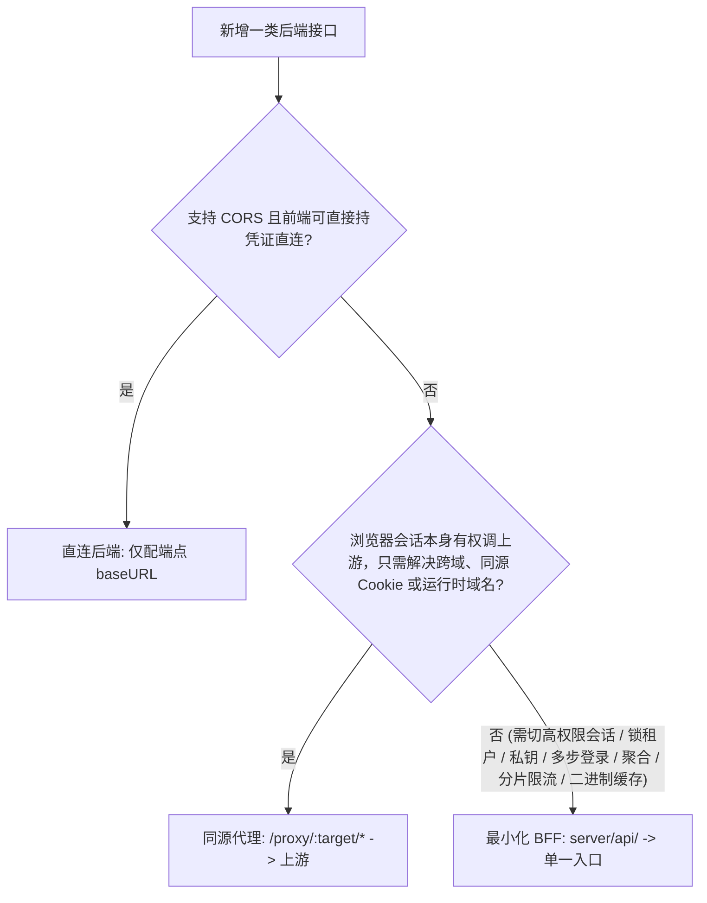

在 Nuxt 项目接入 `@movk/nuxt` 后，架构变复杂通常只有两个原因：**在 `$api` / `useApiFetch` 外面重复封装拦截器**，以及**为了改字段名、透传接口或按 REST 拆文件写了大量 BFF 空壳路由与多层包装函数**。

本文直接给出可落地的边界、选型顺序、硬性分层约束与最小示例，避免项目 API 层被重重包裹。

## 职责边界

先把 `@movk/nuxt` 已内置的能力与项目需要决策的部分划清：

| 归属 | 负责什么 | 参考文档 |
| --- | --- | --- |
| **`@movk/nuxt` 已内置** | 多端点 `$api` 创建与缓存、服务端 `headers` 与客户端 `publicHeaders` 隔离 | [端点配置](/docs/getting-started/configuration#endpoints) · [$api](/docs/api/api-plugin) |
| **`@movk/nuxt` 已内置** | 从 Session 自动注入 Token、401 自动清会话跳登录、`movk:api:unauthorized` Hook | [认证集成](/docs/api/api-plugin#认证集成) · [Hooks](/docs/api/hooks#movkapiunauthorized) |
| **`@movk/nuxt` 已内置** | 业务状态码校验（`businessCheck`）、数据解包（`unwrap`）、`ApiError` 归一与 Toast 过滤 | [概览](/docs/api) · [$api](/docs/api/api-plugin) |
| **`@movk/nuxt` 已内置** | SSR/CSR 缓存与去重 Key（`useApiFetch` 家族）、上传下载进度、SSE 流式解析 | [useApiFetch](/docs/api/use-api-fetch) · [上传与下载](/docs/api/upload-download) · [流式请求](/docs/api/stream) |
| **你的项目负责** | 决定每类接口走直连 / 同源代理 / 最小化 BFF、管理领域契约与极薄的服务端边界 | 本文 |

::note
API 域依赖 Nuxt 运行时与服务端私有配置隔离，**仅在 Nuxt 模式下可用**；纯 Vue + Vite 模式仅包含 UI 组件、AutoForm、DataTable 与通用 Composables。
::

## 选型决策树

按**“直连 → 同源代理 → 最小化 BFF”**的顺序判断，同一个项目可以通过多端点混合使用：



| 方式 | 请求链路 | 适用场景 |
| --- | --- | --- |
| **直连后端** | 页面 → 后端 | 公开 API 或已配好 CORS、前端可直接携带凭证，零服务端代码 |
| **同源代理** | 页面 → `/proxy/**` → 后端 | 浏览器持有的会话已有权访问上游（如直调 `/proxy/gateway/:menuId/:buttonId`），只需隐藏内网地址、消除跨域、共享同源 Cookie 或容器运行时切换后端域名 |
| **最小化 BFF** | 页面 → `server/api/` → 上游 | 持有私有密钥、必须由服务端切换高权限会话并锁定租户参数、多步登录写 Session、多上游聚合、分片并发限流或二进制压缩与缓存 |

::tip
**别为了“洗字段名”或“直调网关路径”写 BFF**：
- 上游返回 `snake_case` 或裸数组时，关闭端点的 `businessCheck` 与 `unwrap`，把 Zod `.transform()` 写在 `shared/contracts/` 里，配合 `useApiFetch` 的 `transform` 在前端一次转换即可。
- 只要浏览器自身的会话就能调通网关接口且后端自行按会话校验租户，直接在 `app/composables/api/` 调同源代理端点，不要建 BFF。
::

## 分层规则（硬约束）

保持每条调用链路清晰可追，遵守以下 6 条约束：

1. **契约只解析一次**：`shared/contracts/` 集中存放 Zod schema 与字段映射；前端直连/代理只在 Composable 或 `transform` 中解析一次，BFF 输出已映射好的页面模型，不在前后端各洗一遍。
2. **前端按领域直调**：`app/composables/api/` 按业务领域建文件，直接调用 `$api`、`useApiFetch` / `useClientApiFetch`，不自建 `request.ts` 二次包装。
3. **服务端只留单工厂与单入口**：`server/utils/` 只放一个上游客户端工厂（统一超时、日志与 `502/504` 映射）和一个同类上游的统一调用入口（如网关上下文与信封解包）。
4. **路由保持门卫职责**：`server/api/` 路由只做“参数校验 → 调用一个 Service/工具函数 → 返回统一响应信封”，避免在路由里写循环、聚合与重试。
5. **同类上游最多两层**：`路由 → 唯一调用入口 → 上游`，同类上游只允许存在一个调用入口，禁止再套“专用透传层 + 通用封装层”。
6. **消灭空壳路由与单调用方包装**：只服务于单一调用方的中转函数一律内联；必须走 BFF 的同类 CRUD/查询不要手写十几个 `[id].get/put/delete.ts` 空壳文件，收口到**读写双操作表**（`query/[op].get.ts` + `action/[op].post.ts`）。

## 三种接入方式示例

::code-tree{defaultValue="nuxt.config.ts" expandAll}

```ts [nuxt.config.ts]
const baseURL = process.env.NUXT_APP_BASE_URL || '/'

export default defineNuxtConfig({
  modules: ['@movk/nuxt'],
  app: { baseURL },
  // 运行时通过 NUXT_GATEWAY_URL / NUXT_SENSOR_URL / NUXT_ORDERS_TOKEN 注入
  runtimeConfig: {
    gatewayUrl: '',
    sensorUrl: '',
    ordersToken: ''
  },
  movk: {
    api: {
      // 仅变更类请求自动弹成功 Toast，GET 查询保持安静
      toast: {
        success: { methods: ['POST', 'PUT', 'PATCH', 'DELETE'] }
      },
      endpoints: {
        // 1. 最小化 BFF：默认启用 { code, message, data } 校验与解包
        default: { baseURL: `${baseURL}api` },
        // 2. 同源代理：上游多数返回裸数据，关闭默认解包，按需在单次请求开启
        gateway: {
          baseURL: `${baseURL}proxy/gateway`,
          response: { businessCheck: false, unwrap: false, messageKey: 'msg' }
        },
        // 3. 无鉴权外部/内部裸数据服务：必须显式关闭 auth，防主站 Token 外泄与误清会话
        sensor: {
          baseURL: `${baseURL}proxy/sensor`,
          response: { businessCheck: false, unwrap: false },
          auth: {
            enabled: false,
            unauthorized: { clearSession: false, redirect: false }
          }
        }
      }
    }
  }
})
```

```ts [shared/contracts/sensor.ts]
import { z } from 'zod'

// 上游 snake_case 字段直接在共享契约层转换一次，不建透传 BFF
const upstreamReadingSchema = z.object({
  point_number: z.string(),
  sensor_value: z.number().nullable()
}).transform(({ point_number, sensor_value }) => ({
  pointNumber: point_number,
  value: sensor_value
}))

export type SensorReading = z.infer<typeof upstreamReadingSchema>
export const parseReadings = (raw: unknown): SensorReading[] => z.array(upstreamReadingSchema).parse(raw)
```

```ts [app/composables/api/useSensor.ts]
import { parseReadings, type SensorReading } from '#shared/contracts/sensor'

export function useSensorLatest(point: Ref<string>, active: Ref<boolean>) {
  return useClientApiFetch<unknown, SensorReading[]>('/readings/latest', {
    endpoint: 'sensor',
    query: { point },
    enabled: computed(() => active.value && Boolean(point.value)),
    transform: parseReadings,
    toast: false
  })
}

export async function fetchCaptcha() {
  const { $api } = useNuxtApp()
  // 同端点下个别带标准信封的接口，单次请求覆盖开启校验与解包
  return await $api.use('gateway')<{ captchaId: string, img: string }>('/v1/captcha/get', {
    businessCheck: true,
    unwrap: true,
    toast: { success: false }
  })
}
```

```ts [app/composables/api/useAdmin.ts]
// 必须经 BFF 切会话/锁租户的管理操作，前端只用两个 1 行辅助函数对齐读写操作表
export function useAdminApi() {
  const { $api } = useNuxtApp()
  const query = <T>(op: 'users' | 'roles' | 'userDetail', params?: Record<string, unknown>) =>
    $api<T>(`/admin/query/${op}`, { ...(params ? { query: params } : {}) })
  const act = <T = null>(op: 'createUser' | 'removeUser', body: Record<string, unknown>) =>
    $api<T>(`/admin/action/${op}`, { method: 'POST', body })

  return {
    listUsers: (params: { page: number }) => query('users', params),
    getUserDetail: (id: string) => query('userDetail', { id }),
    createUser: (body: { name: string }) => act('createUser', body),
    removeUser: (id: string) => act('removeUser', { id })
  }
}
```

```ts [server/routes/proxy/[target]/[...path].ts]
export default defineEventHandler((event) => {
  const target = getRouterParam(event, 'target')
  const config = useRuntimeConfig(event)
  // 白名单限制可代理的上游，防止开放代理（SSRF）
  const upstreams: Record<string, string | undefined> = {
    gateway: config.gatewayUrl,
    sensor: config.sensorUrl
  }

  const upstreamBase = target ? upstreams[target] : undefined
  if (!upstreamBase) {
    throw createError({ statusCode: 404, message: '未知代理目标' })
  }

  const path = getRouterParam(event, 'path') || ''
  if (path.split('/').includes('..')) {
    throw createError({ statusCode: 400, message: '非法请求路径' })
  }

  const { search } = getRequestURL(event)
  const base = new URL(upstreamBase.replace(/\/$/, ''))
  const targetUrl = `${base.origin}${base.pathname.replace(/\/$/, '')}/${path.replace(/^\//, '')}${search}`
  if (new URL(targetUrl).origin !== base.origin) {
    throw createError({ statusCode: 400, message: '非法请求路径' })
  }
  return proxyRequest(event, targetUrl)
})
```

```ts [server/utils/upstream.ts]
import type { z } from 'zod'

export function parseUpstream<T>(schema: z.ZodType<T>, raw: unknown, name: string): T {
  const result = schema.safeParse(raw)
  if (!result.success) {
    console.error(`[upstream:${name}] schema mismatch`, result.error.issues.slice(0, 5))
    throw createError({ statusCode: 502, message: `${name}返回数据格式异常` })
  }
  return result.data
}

export function createUpstream(name: string, baseURL: string, headers?: Record<string, string>) {
  if (!baseURL) {
    throw createError({ statusCode: 500, message: `未配置 ${name} 地址` })
  }
  return $fetch.create({
    baseURL,
    headers,
    timeout: 10_000,
    retry: 0,
    onResponseError({ response }) {
      throw createError({ statusCode: response.status === 404 ? 404 : 502, message: `${name}异常` })
    },
    onRequestError({ error }) {
      if (error.name === 'AbortError') throw error
      throw createError({ statusCode: error.name === 'TimeoutError' ? 504 : 502, message: `${name}不可用` })
    }
  })
}
```

```ts [server/api/admin/query/[op].get.ts]
import { z } from 'zod'

// 读操作与详情聚合收口到 GET 操作表（GET 保持静默，不触发 POST 成功 Toast）
const READS = {
  users: { schema: z.object({ page: z.coerce.number().default(1) }), run: (q: { page: number }) => queryAdmin('user.list', q) },
  userDetail: { schema: z.object({ id: z.string().min(1) }), run: (q: { id: string }) => fetchUserDetail(q.id) }
} as const

const paramsSchema = z.object({ op: z.enum(['users', 'userDetail']) })

export default defineEventHandler(async (event) => {
  await requireUserSession(event)
  const { op } = await getValidatedRouterParams(event, paramsSchema.parse)
  const query = await getValidatedQuery(event, data => READS[op].schema.parse(data))
  return { code: 200, message: 'ok', data: await READS[op].run(query) }
})
```

```ts [server/api/admin/action/[op].post.ts]
import { z } from 'zod'

// 写操作统一收口到 POST 操作表（自动命中 toast.success.methods 弹出 message），告别几十个空壳文件
const ACTIONS = {
  createUser: { schema: z.object({ name: z.string().min(1) }), run: (b: { name: string }) => saveUser(b), message: '新增用户成功' },
  removeUser: { schema: z.object({ id: z.string().min(1) }), run: (b: { id: string }) => deleteUser(b.id), message: '删除用户成功' }
} as const

const paramsSchema = z.object({ op: z.enum(['createUser', 'removeUser']) })

export default defineEventHandler(async (event) => {
  await requireUserSession(event)
  const { op } = await getValidatedRouterParams(event, paramsSchema.parse)
  const body = await readValidatedBody(event, data => ACTIONS[op].schema.parse(data))
  await ACTIONS[op].run(body)
  return { code: 200, message: ACTIONS[op].message, data: null }
})
```

::

::note
**为什么用 `createError({ statusCode, message })` 而不是 `statusMessage` 放中文？** HTTP 状态行的 `statusMessage` 只能包含 ASCII 字符，传入中文会导致 Node / Undici 直接抛 `Invalid character in statusMessage` 变成 500；中文提示放进 `message`，`@movk/nuxt` 会自动提取展示。
::

## Auth 的两种架构

无论采用哪种方式，底层均使用 `nuxt-auth-utils` 管理加密 Cookie，**生产环境须设置至少 32 位的 `NUXT_APP_SECRET`**。

### 情况 A：后端内置 Auth（后端签发 Token / SessionId）

适用场景：独立认证中心或网关签发 Token，前端直连或经同源代理携带自定义请求头。

1. 开启 `movk.api.auth.enabled: true`（默认从 `session.token` 读取，自动注入请求头并在 `401` 时清会话跳 `/login`；非标头如 `sessionId` 只需补 `headerName: 'sessionId', tokenType: 'Custom'`）。
2. 登录接口拿到 Token 后调 `await setUserSession(event, { user, token })`。
3. 登录页成功后依次执行 `await useUserSession().fetch()` 与 `clearNuxtData()`，再跳转页面，防止闪现旧账号缓存。
4. 如需静默续期，注册 `movk:api:unauthorized` Hook，续期成功后设 `result.handled = true` 并调 `refreshNuxtData()`。

::tip
若安全要求浏览器 JS 完全不可见 Token，可将 Token 存入 `setUserSession(event, { user, secure: { token } })`，关闭 `movk.api.auth.enabled`，改为在同源代理 `proxy/[target]/[...path].ts` 中通过 `getUserSession(event)` 取出 `secure.token` 注入上游。
::

### 情况 B：后端无内置 Auth（Nuxt 自己管会话，或上游只认服务密钥）

适用场景：内部算法/数据服务只认固定服务密钥，或 Nuxt 全栈自建数据库登录。

1. 显式安装并注册 `nuxt-auth-utils` 模块，保持 `movk.api.auth.enabled: false`（`auth.unauthorized` 仍可在 401 时清会话跳登录）。
2. BFF 入口调 `const { user } = await requireUserSession(event)` 鉴权，再使用 `useRuntimeConfig(event)` 中的私有密钥请求上游。
3. 在 `app/plugins/ssr-cookie.server.ts` 自动向站内同源端点转发 Cookie，解决 SSR 首屏调 `/api` 的鉴权问题（绝不向第三方外域透传）：

```ts [app/plugins/ssr-cookie.server.ts]
export default defineNuxtPlugin((nuxtApp) => {
  const { cookie } = useRequestHeaders(['cookie'])
  if (!cookie) return

  nuxtApp.hook('movk:api:request', ({ request, options }) => {
    const base = options.baseURL || ''
    const url = typeof request === 'string' ? request : ''
    const isSameOrigin = (base.startsWith('/') && !base.startsWith('//'))
      || (!base && url.startsWith('/') && !url.startsWith('//'))
    if (!isSameOrigin) return

    const headers = new Headers(options.headers as HeadersInit | undefined)
    if (!headers.has('cookie')) {
      headers.set('cookie', cookie)
      options.headers = headers
    }
  })
})
```

## 反模式清单

出现下面任意一条，说明 API 层开始过度复杂化，应立即收口：

| 反模式 | 问题 | 正确做法 |
| --- | --- | --- |
| 为改字段名写 BFF | 平白多一层网络中转与几十个透传文件 | 关掉端点的 `unwrap`，在 `shared/contracts/` 用 Zod `.transform()` 洗一次 |
| 前后端各解析一遍 | 服务端映射一遍 DTO，前端契约又 `safeParse` 一遍 | 明确唯一解析点：代理/直连在前端解析，BFF 则直接输出页面模型 |
| 每个 CRUD 建一个空壳路由 | 手写十几个 `[id].get/put/delete.ts`，只做校验+转发 | 收口到读写双操作表（`query/[op].get.ts` + `action/[op].post.ts`） |
| 同类上游建多个 Client 工厂 | `createClientA` / `createClientB` 散落各处，超时与错误映射不一致 | 一个 `server/utils/gateway.ts` 放统一 `createUpstream` 与单一调用入口 |
| 多种响应信封并存 | BFF 混用原始网关信封与自定义 `{ code, data }`，前端被迫写两套解包逻辑 | 自建 BFF 统一返回 Movk 默认信封；原始结构只走直连或同源代理端点 |
| 保留单调用方中间层 | `route → helperA → helperB → service → client` 层层转手 | 只服务一个调用方的函数直接内联，同类上游调用链路不超过两层 |
| 中文塞进 `statusMessage` | Node/Undici 校验 HTTP 状态行只允许 ASCII，直接 500 崩溃 | 错误文案放进 `createError({ statusCode, message })` |

## 新增接口检查清单

每次新增后端接口前，按顺序核对以下 7 项：

1. **先判拓扑**：能直连不走代理，能同源代理不写 BFF；只有涉及私钥、高权限会话切换/锁租户、多步登录、多接口聚合、分片限流或二进制缓存才建 `server/api/`。
2. **选对端点配置**：裸数组或第三方无鉴权接口，确认端点已配置 `response: { businessCheck: false, unwrap: false }` 与 `auth: { enabled: false }`。
3. **契约落盘一处**：输入输出 schema 放 `shared/contracts/`，只在一个位置解析，不重复校验或映射。
4. **控制弹窗与并发**：`GET` 查询保持静默（全局 `toast.success.methods` 限定变更方法）；同页多请求用 `useAsyncData` + `Promise.all` 并发，避免多个 `await useApiFetch` 排队。
5. **留意 `enabled` 门控时机**：`useAsyncData` / `useClientApiFetch` 的 `enabled` 仅阻断/取消，不会在 `false -> true` 时自动补发；按需抽屉面板需配合 `watch(enabled)` 在 `status === 'idle'` 时手动调用 `execute()`。
6. **守住错误边界**：上游 `ZodError` 与连接异常在服务端统一收口为 `502` / `504`（使用 `message` 传中文），绝不把上游堆栈或内部配置透出给浏览器。
7. **复用已有入口**：新增同类管理读写操作时，直接登记到既有读写操作表（`ADMIN_READS` / `ADMIN_ACTIONS`），不复制独立路由与服务模板。
