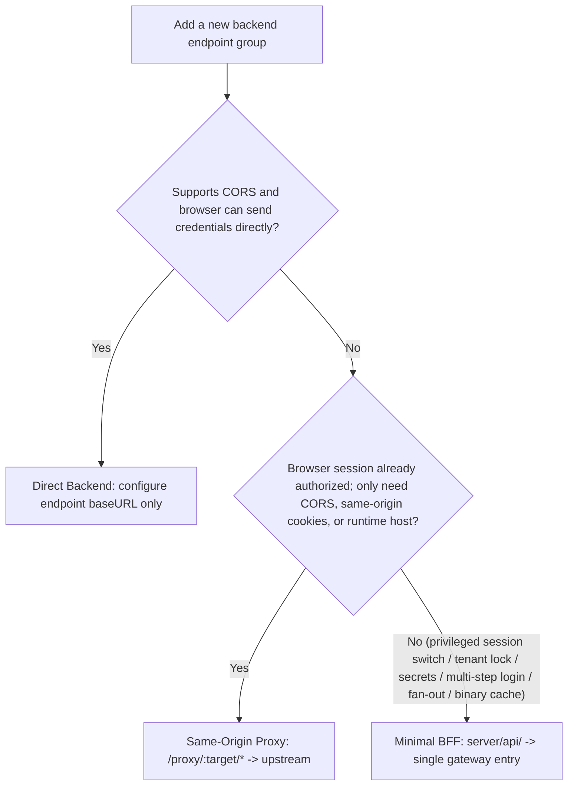

When setting up a Nuxt project with `@movk/nuxt`, over-complication almost always comes from two habits: **wrapping `$api` / `useApiFetch` in another custom interceptor layer**, and **writing dozens of pass-through BFF files or wrapper functions just to rename fields or expose REST routes**.

This guide establishes a practical boundary, selection order, strict layering rules, and minimal examples so your API layer stays flat and maintainable.

## Responsibility Boundary

Separate what `@movk/nuxt` already handles from what your application decides:

| Owner | Responsibilities | Reference |
| --- | --- | --- |
| **Built into `@movk/nuxt`** | Multi-endpoint `$api` creation & caching, isolating server-only `headers` from client `publicHeaders` | [Endpoints](/en/docs/getting-started/configuration#endpoints) · [$api](/en/docs/api/api-plugin) |
| **Built into `@movk/nuxt`** | Automatic token injection from session, 401 session cleanup & login redirect, `movk:api:unauthorized` hook | [Auth Integration](/en/docs/api/api-plugin#auth-integration) · [Hooks](/en/docs/api/hooks#movkapiunauthorized) |
| **Built into `@movk/nuxt`** | Business status checks (`businessCheck`), unwrapping (`unwrap`), normalized `ApiError`, method-filtered toasts | [Overview](/en/docs/api) · [$api](/en/docs/api/api-plugin) |
| **Built into `@movk/nuxt`** | SSR/CSR caching & dedupe keys (`useApiFetch` family), upload/download progress, SSE streaming | [useApiFetch](/en/docs/api/use-api-fetch) · [Upload & Download](/en/docs/api/upload-download) · [Streaming](/en/docs/api/stream) |
| **Your Application** | Choosing direct / same-origin proxy / minimal BFF per endpoint, domain contracts, and thin server boundaries | This guide |

::note
The API domain relies on the Nuxt runtime and server-private `runtimeConfig` isolation — **it is only available in Nuxt mode**. Plain Vue + Vite mode includes UI components, AutoForm, DataTable, and general-purpose composables.
::

## Selection Decision Tree

Evaluate every backend integration in the order **Direct → Same-Origin Proxy → Minimal BFF**. One project can mix all three via multiple endpoints:



| Pattern | Request Path | When to Choose It |
| --- | --- | --- |
| **Direct Backend** | App → Backend | Public API or CORS-enabled backend where the browser carries credentials directly — zero server code |
| **Same-Origin Proxy** | App → `/proxy/**` → Backend | Browser's own session already authorizes the upstream path (e.g. `/proxy/gateway/:menuId/:buttonId`); you only hide internal hosts, avoid CORS, share cookies, or switch upstream URLs at runtime |
| **Minimal BFF** | App → `server/api/` → Upstream | Requires server-only secrets, privileged session switching with server-enforced tenant params, multi-step login cookie setup, multi-upstream aggregation, sharded concurrency limits, or binary packing & caching |

::tip
**Do not build a BFF just to rename fields or proxy direct gateway paths**:
- When an upstream returns `snake_case` or bare arrays, disable `businessCheck` and `unwrap` on that endpoint, put a Zod `.transform()` in `shared/contracts/`, and pass it to `useApiFetch`'s `transform` option once on the client.
- If the browser's own session already has permission to call a gateway path and the backend isolates tenants by session, call the same-origin proxy directly from `app/composables/api/` without a BFF.
::

## Layering Rules (Hard Constraints)

Keep every request path easy to trace by following six constraints:

1. **Parse contracts once**: keep Zod schemas and field mappings in `shared/contracts/`. Direct/proxy endpoints parse once in the composable or `transform`; BFFs output the final view model without re-parsing on both sides.
2. **Call directly per domain on the client**: organize `app/composables/api/` by domain and call `$api`, `useApiFetch`, or `useClientApiFetch` directly — never add a custom `request.ts` wrapper.
3. **One upstream factory and one entry on the server**: keep a single upstream client factory (timeout, logging, `502/504` mapping) and a single call helper per upstream family (context switching + envelope unwrapping) in `server/utils/`.
4. **Keep routes as thin gatekeepers**: `server/api/` handlers only validate params/body, call one service/helper function, and return the unified response envelope — no loops, retries, or aggregations inside route files.
5. **At most two server layers per upstream**: `route → single upstream entry → upstream`. Never stack specialized pass-through helpers on top of generic helpers.
6. **Eliminate single-caller wrappers and shell routes**: inline any helper with only one caller; consolidate repetitive BFF CRUD/query endpoints into **dual read/write operation tables** (`query/[op].get.ts` + `action/[op].post.ts`) instead of maintaining dozens of `[id].get/put/delete.ts` files.

## Three Integration Patterns Example

::code-tree{defaultValue="nuxt.config.ts" expandAll}

```ts [nuxt.config.ts]
const baseURL = process.env.NUXT_APP_BASE_URL || '/'

export default defineNuxtConfig({
  modules: ['@movk/nuxt'],
  app: { baseURL },
  // Injected at container runtime via NUXT_GATEWAY_URL / NUXT_SENSOR_URL / NUXT_ORDERS_TOKEN
  runtimeConfig: {
    gatewayUrl: '',
    sensorUrl: '',
    ordersToken: ''
  },
  movk: {
    api: {
      // Show automatic success toasts only for mutating methods; keep GET queries silent
      toast: {
        success: { methods: ['POST', 'PUT', 'PATCH', 'DELETE'] }
      },
      endpoints: {
        // 1. Minimal BFF: enables { code, message, data } validation and unwrapping by default
        default: { baseURL: `${baseURL}api` },
        // 2. Same-origin proxy: mostly raw responses; opt in per request when needed
        gateway: {
          baseURL: `${baseURL}proxy/gateway`,
          response: { businessCheck: false, unwrap: false, messageKey: 'msg' }
        },
        // 3. Unauthenticated service returning bare arrays: disable auth to prevent token leaks & false logouts
        sensor: {
          baseURL: `${baseURL}proxy/sensor`,
          response: { businessCheck: false, unwrap: false },
          auth: {
            enabled: false,
            unauthorized: { clearSession: false, redirect: false }
          }
        }
      }
    }
  }
})
```

```ts [shared/contracts/sensor.ts]
import { z } from 'zod'

// Convert upstream snake_case once in the shared contract layer — no pass-through BFF needed
const upstreamReadingSchema = z.object({
  point_number: z.string(),
  sensor_value: z.number().nullable()
}).transform(({ point_number, sensor_value }) => ({
  pointNumber: point_number,
  value: sensor_value
}))

export type SensorReading = z.infer<typeof upstreamReadingSchema>
export const parseReadings = (raw: unknown): SensorReading[] => z.array(upstreamReadingSchema).parse(raw)
```

```ts [app/composables/api/useSensor.ts]
import { parseReadings, type SensorReading } from '#shared/contracts/sensor'

export function useSensorLatest(point: Ref<string>, active: Ref<boolean>) {
  return useClientApiFetch<unknown, SensorReading[]>('/readings/latest', {
    endpoint: 'sensor',
    query: { point },
    enabled: computed(() => active.value && Boolean(point.value)),
    transform: parseReadings,
    toast: false
  })
}

export async function fetchCaptcha() {
  const { $api } = useNuxtApp()
  // Opt into envelope checking and unwrapping for a single endpoint route
  return await $api.use('gateway')<{ captchaId: string, img: string }>('/v1/captcha/get', {
    businessCheck: true,
    unwrap: true,
    toast: { success: false }
  })
}
```

```ts [app/composables/api/useAdmin.ts]
// For BFF-protected operations, align the client with two 1-line helpers against the read/write tables
export function useAdminApi() {
  const { $api } = useNuxtApp()
  const query = <T>(op: 'users' | 'roles' | 'userDetail', params?: Record<string, unknown>) =>
    $api<T>(`/admin/query/${op}`, { ...(params ? { query: params } : {}) })
  const act = <T = null>(op: 'createUser' | 'removeUser', body: Record<string, unknown>) =>
    $api<T>(`/admin/action/${op}`, { method: 'POST', body })

  return {
    listUsers: (params: { page: number }) => query('users', params),
    getUserDetail: (id: string) => query('userDetail', { id }),
    createUser: (body: { name: string }) => act('createUser', body),
    removeUser: (id: string) => act('removeUser', { id })
  }
}
```

```ts [server/routes/proxy/[target]/[...path].ts]
export default defineEventHandler((event) => {
  const target = getRouterParam(event, 'target')
  const config = useRuntimeConfig(event)
  // Restrict proxy targets with an explicit allowlist to prevent open proxy (SSRF)
  const upstreams: Record<string, string | undefined> = {
    gateway: config.gatewayUrl,
    sensor: config.sensorUrl
  }

  const upstreamBase = target ? upstreams[target] : undefined
  if (!upstreamBase) {
    throw createError({ statusCode: 404, message: 'Unknown proxy target' })
  }

  const path = getRouterParam(event, 'path') || ''
  if (path.split('/').includes('..')) {
    throw createError({ statusCode: 400, message: 'Invalid request path' })
  }

  const { search } = getRequestURL(event)
  const base = new URL(upstreamBase.replace(/\/$/, ''))
  const targetUrl = `${base.origin}${base.pathname.replace(/\/$/, '')}/${path.replace(/^\//, '')}${search}`
  if (new URL(targetUrl).origin !== base.origin) {
    throw createError({ statusCode: 400, message: 'Invalid request path' })
  }
  return proxyRequest(event, targetUrl)
})
```

```ts [server/utils/upstream.ts]
import type { z } from 'zod'

export function parseUpstream<T>(schema: z.ZodType<T>, raw: unknown, name: string): T {
  const result = schema.safeParse(raw)
  if (!result.success) {
    console.error(`[upstream:${name}] schema mismatch`, result.error.issues.slice(0, 5))
    throw createError({ statusCode: 502, message: `${name} returned an unexpected payload` })
  }
  return result.data
}

export function createUpstream(name: string, baseURL: string, headers?: Record<string, string>) {
  if (!baseURL) {
    throw createError({ statusCode: 500, message: `Missing ${name} baseURL` })
  }
  return $fetch.create({
    baseURL,
    headers,
    timeout: 10_000,
    retry: 0,
    onResponseError({ response }) {
      throw createError({ statusCode: response.status === 404 ? 404 : 502, message: `${name} error` })
    },
    onRequestError({ error }) {
      if (error.name === 'AbortError') throw error
      throw createError({ statusCode: error.name === 'TimeoutError' ? 504 : 502, message: `${name} unavailable` })
    }
  })
}
```

```ts [server/api/admin/query/[op].get.ts]
import { z } from 'zod'

// Consolidate reads & detail aggregations into GET ops (keeps GET silent without POST success toasts)
const READS = {
  users: { schema: z.object({ page: z.coerce.number().default(1) }), run: (q: { page: number }) => queryAdmin('user.list', q) },
  userDetail: { schema: z.object({ id: z.string().min(1) }), run: (q: { id: string }) => fetchUserDetail(q.id) }
} as const

const paramsSchema = z.object({ op: z.enum(['users', 'userDetail']) })

export default defineEventHandler(async (event) => {
  await requireUserSession(event)
  const { op } = await getValidatedRouterParams(event, paramsSchema.parse)
  const query = await getValidatedQuery(event, data => READS[op].schema.parse(data))
  return { code: 200, message: 'ok', data: await READS[op].run(query) }
})
```

```ts [server/api/admin/action/[op].post.ts]
import { z } from 'zod'

// Consolidate mutations into POST ops (automatically triggers toast.success.methods) instead of dozens of shell files
const ACTIONS = {
  createUser: { schema: z.object({ name: z.string().min(1) }), run: (b: { name: string }) => saveUser(b), message: 'User created' },
  removeUser: { schema: z.object({ id: z.string().min(1) }), run: (b: { id: string }) => deleteUser(b.id), message: 'User deleted' }
} as const

const paramsSchema = z.object({ op: z.enum(['createUser', 'removeUser']) })

export default defineEventHandler(async (event) => {
  await requireUserSession(event)
  const { op } = await getValidatedRouterParams(event, paramsSchema.parse)
  const body = await readValidatedBody(event, data => ACTIONS[op].schema.parse(data))
  await ACTIONS[op].run(body)
  return { code: 200, message: ACTIONS[op].message, data: null }
})
```

::

::note
**Why `createError({ statusCode, message })` instead of putting localized text in `statusMessage`?** HTTP status lines only allow ASCII characters — passing non-ASCII text in `statusMessage` causes Node / Undici to throw `Invalid character in statusMessage` as a 500 error. Put user-facing messages in `message`, which `@movk/nuxt` extracts automatically.
::

## Two Authentication Architectures

Both patterns rely on `nuxt-auth-utils` for encrypted session cookies. **Always configure at least a 32-character `NUXT_APP_SECRET` in production.**

### Pattern A: Built-in Backend Auth (Backend Issues Token / SessionId)

When an auth service or gateway issues tokens and expects them in a header (`Authorization: Bearer <token>` or a custom header like `sessionId`):

1. Enable `movk.api.auth.enabled: true` (reads `session.token` by default, injects the header, and handles 401 cleanup + `/login` redirect; for custom headers such as `sessionId`, set `headerName: 'sessionId', tokenType: 'Custom'`).
2. In your login handler, call `await setUserSession(event, { user, token })`.
3. On the login page after success, run `await useUserSession().fetch()` followed by `clearNuxtData()` before navigating so stale data from a previous account never flashes.
4. For silent token refresh, hook `movk:api:unauthorized`, set `result.handled = true` on success, and call `refreshNuxtData()`.

::tip
If security rules forbid exposing the raw token to browser JS, store it in `setUserSession(event, { user, secure: { token } })`, set `movk.api.auth.enabled: false`, and inject `secure.token` inside `proxy/[target]/[...path].ts` using `getUserSession(event)`.
::

### Pattern B: No Built-in Backend Auth (Nuxt Manages Sessions, or Upstream Uses a Service Key)

When upstreams only accept a static server API key or Nuxt handles user login directly:

1. Register `nuxt-auth-utils` explicitly in `modules` and keep `movk.api.auth.enabled: false` (`auth.unauthorized` still cleans up sessions and redirects on 401).
2. Call `const { user } = await requireUserSession(event)` in protected BFF routes before calling upstreams with private keys from `useRuntimeConfig(event)`.
3. Forward cookies to same-origin `/api` requests during SSR in `app/plugins/ssr-cookie.server.ts` (never forward cookies to external domains):

```ts [app/plugins/ssr-cookie.server.ts]
export default defineNuxtPlugin((nuxtApp) => {
  const { cookie } = useRequestHeaders(['cookie'])
  if (!cookie) return

  nuxtApp.hook('movk:api:request', ({ request, options }) => {
    const base = options.baseURL || ''
    const url = typeof request === 'string' ? request : ''
    const isSameOrigin = (base.startsWith('/') && !base.startsWith('//'))
      || (!base && url.startsWith('/') && !url.startsWith('//'))
    if (!isSameOrigin) return

    const headers = new Headers(options.headers as HeadersInit | undefined)
    if (!headers.has('cookie')) {
      headers.set('cookie', cookie)
      options.headers = headers
    }
  })
})
```

## Anti-Pattern Checklist

Any of the following signs means your API layer is becoming over-engineered and should be simplified immediately:

| Anti-Pattern | Problem | Recommended Fix |
| --- | --- | --- |
| Writing a BFF just to rename fields | Adds extra network hops and dozens of pass-through routes | Disable `unwrap` on the endpoint and transform once in `shared/contracts/` via Zod |
| Parsing twice on server and client | Server maps DTOs and client runs `safeParse` again | Pick one parsing boundary: parse in client composables for direct/proxy, or return view models directly from BFF |
| One shell route per CRUD endpoint | Dozens of `[id].get/put/delete.ts` files repeating validate + forward | Consolidate into read/write operation tables (`query/[op].get.ts` + `action/[op].post.ts`) |
| Multiple client factories per upstream | Timeout, logging, and error mapping diverge across files | Keep a single `createUpstream` and one entry helper in `server/utils/gateway.ts` |
| Mixing incompatible envelopes | BFF mixes raw upstream envelopes with custom `{ code, data }` | Always return Movk's default envelope from custom BFFs; keep raw payloads on proxy/direct endpoints |
| Single-caller intermediate wrappers | `route → helperA → helperB → service → client` indirection | Inline single-caller helpers; keep at most two server layers per upstream |
| Non-ASCII text in `statusMessage` | Node/Undici rejects non-ASCII HTTP status lines with 500 | Always pass localized error text in `createError({ statusCode, message })` |

## New Endpoint Checklist

Verify these seven items before adding a new backend integration:

1. **Choose the simplest topology**: prefer direct over proxy, and proxy over BFF; only use `server/api/` for secrets, privileged session switching/tenant locking, multi-step login, aggregations, sharded limits, or binary caching.
2. **Match endpoint config to payload shape**: disable `response.businessCheck`, `response.unwrap`, and `auth.enabled` for unauthenticated raw-payload endpoints.
3. **Keep a single parsing point**: store Zod schemas in `shared/contracts/` and validate/map once.
4. **Control toasts and concurrency**: keep `GET` quiet via `toast.success.methods`, and use `useAsyncData` + `Promise.all` instead of sequential `await useApiFetch` waterfalls.
5. **Handle `enabled` gating transitions**: `useAsyncData` / `useClientApiFetch` `enabled` only gates and aborts requests — it does not auto-trigger when switching `false → true`, so watch `enabled` and call `execute()` when `status === 'idle'`.
6. **Guard error boundaries**: map upstream schema mismatches and connection failures to `502` / `504` on the server (using `message` for localized text), never leaking stack traces or internal config.
7. **Reuse existing operation tables**: register new similar admin reads or mutations in `ADMIN_READS` / `ADMIN_ACTIONS` instead of duplicating route and service boilerplate.
